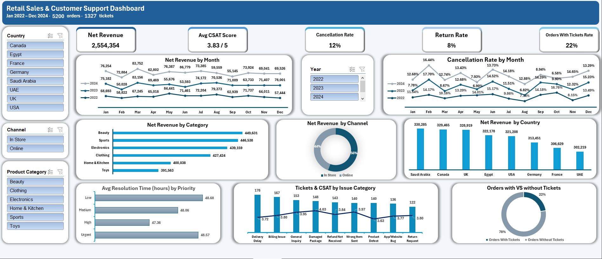

# Retail Sales & Customer Support Analysis

## Overview
Cleaning and analysis of messy retail sales and customer support data (Jan 2022 – Dec 2024) using Excel, Power Query, and Power Pivot, with an interactive dashboard.

Dataset: source not recorded.

## Dashboard

## Key Metrics
- Orders: 5,200
- Support tickets: 1,327
- Net Revenue: 2,554,354
- Avg CSAT Score: 3.83 / 5
- Cancellation Rate: 12%
- Return Rate: 8%
- Orders with tickets: 22%

## Key Findings
- Beauty was the top category by net revenue (449,631), and Toys the lowest (391,563).
- In-store sales made up 56% of net revenue and online 44%.
- Delivery Delay (178) and Billing Issue (167) were the most common ticket categories.
- Average resolution time was almost the same across all priority levels (about 47 to 49 hours).

## What I Did
- Cleaned the raw data using Power Query and documented 31 data-cleaning steps
- Modeled the data with Power Pivot
- Built an interactive dashboard with slicers for country, channel, product category, and year, tracking revenue, cancellations, returns, customer satisfaction, ticket volume, and resolution time

## Tools
Excel, Power Query, Power Pivot

## Contact
LinkedIn: https://www.linkedin.com/in/hamza-yosry
